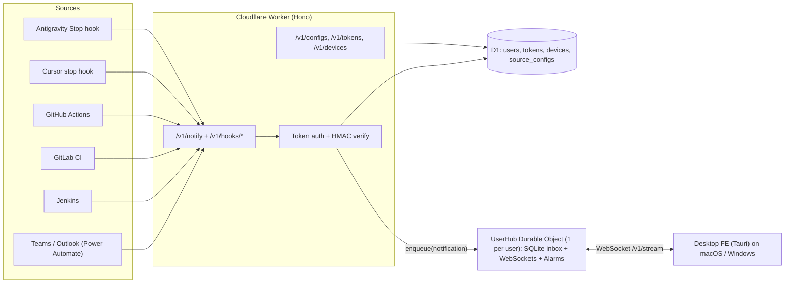
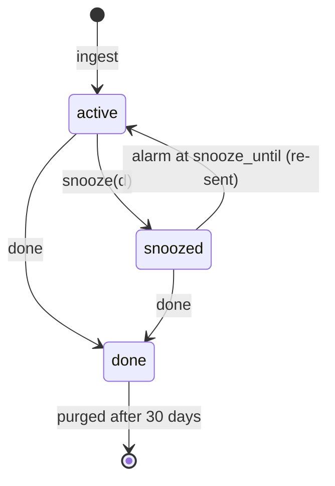

# BE Plan — `noti-reciever-be`

> Stack: **TypeScript · Hono · Cloudflare Workers · Durable Objects (SQLite + WebSocket Hibernation + Alarms) · D1 · Zod · Vitest**
> Hosting: Cloudflare Workers free plan → `https://noti-reciever.<account>.workers.dev`

---

## 1. Goals

- **Public ingest API**: `POST /v1/notify` with `{ source, message }` (plus optional fields), protected by a private token.
- **Adapters** for GitHub / GitLab / Jenkins webhooks, so you don't have to edit every pipeline.
- **Realtime delivery** to the FE (desktop app) over WebSocket.
- **Guaranteed delivery**: if the FE is offline, store the notification and replay it when the FE reconnects.
- **Lifecycle**: `active → snoozed → active → done`. *Snooze* re-sends after X time. *Done* means it's never sent again, and it is dismissed on all devices.
- **CRUD for source configs**: snooze options, level, action buttons.
- **Single user now, multi-user ready** (everything is scoped by `user_id`).

## 2. Architecture



Why this design:
- **Worker** = stateless HTTP edge layer (auth, validation, adapters, CRUD).
- **UserHub Durable Object** = per-user *queue + realtime hub + scheduler*:
  - SQLite inbox = persistent queue (the notification survives while the FE is offline).
  - WebSocket Hibernation = sockets stay open with no idle cost.
  - `setAlarm()` = snooze wake-ups and retry of unacked messages.
- **D1** = global relational data that needs lookups across users (token hash → user).

## 3. Project structure

```
noti-reciever-be/
├─ src/
│  ├─ index.ts               # Hono app, routes, export UserHub
│  ├─ env.ts                 # Bindings typing (DB, USER_HUB, secrets)
│  ├─ routes/
│  │  ├─ notify.ts           # POST /v1/notify
│  │  ├─ hooks/github.ts     # POST /v1/hooks/github
│  │  ├─ hooks/gitlab.ts     # POST /v1/hooks/gitlab
│  │  ├─ hooks/jenkins.ts    # POST /v1/hooks/jenkins
│  │  ├─ configs.ts          # CRUD /v1/configs
│  │  ├─ tokens.ts           # CRUD /v1/tokens (ingest tokens)
│  │  ├─ devices.ts          # /v1/devices, /v1/auth/*
│  │  ├─ notifications.ts    # REST fallback: list/snooze/done
│  │  └─ stream.ts           # GET /v1/stream (WS upgrade → DO)
│  ├─ do/UserHub.ts          # Durable Object
│  ├─ auth/                  # token hashing, middleware, google verify (phase 2)
│  ├─ domain/                # zod schemas, enums, duration parser ("10s","5m")
│  └─ adapters/              # github/gitlab/jenkins payload → Notification
├─ migrations/               # D1 SQL migrations
├─ integrations/             # copy-paste scripts: cursor-stop.js, antigravity-stop.js, Jenkinsfile snippet...
├─ test/                     # vitest + @cloudflare/vitest-pool-workers
├─ wrangler.jsonc
└─ .github/workflows/deploy.yml
```

## 4. Domain model

### Enums

```ts
export const Source = z.enum([
  "teams", "outlook", "jenkins", "gitlab_ci", "github_actions",
  "cursor", "antigravity", "custom",
]);
export const Level = z.enum(["info", "success", "warning", "error"]);
export const ActionMethod = z.enum(["open_url", "webhook", "exec"]);
export const Status = z.enum(["active", "snoozed", "done"]);
```

### Ingest payload (`POST /v1/notify`)

```ts
const NotifyBody = z.object({
  source: Source,                       // required
  message: z.string().min(1).max(2000), // required, also used for TTS
  title: z.string().max(200).optional(),   // e.g. "my-repo #123"
  level: Level.optional(),                 // overrides config default
  url: z.string().url().optional(),        // used by the "open" action
  dedupeKey: z.string().max(200).optional(), // same key within 60s → ignored
  meta: z.record(z.unknown()).optional(),  // free-form data, available to actions as {{meta.x}}
});
```

### Source config (CRUD)

```ts
const ActionSchema = z.discriminatedUnion("method", [
  z.object({ method: z.literal("open_url"), label: z.string(),
             data: z.object({ url: z.string() }) }),                      // supports {{url}}, {{meta.x}}
  z.object({ method: z.literal("webhook"), label: z.string(),
             data: z.object({ url: z.string().url(), httpMethod: z.enum(["GET","POST"]).default("POST"),
                              headers: z.record(z.string()).optional(), body: z.unknown().optional() }) }),
  z.object({ method: z.literal("exec"), label: z.string(),
             data: z.object({ commandId: z.string(), args: z.array(z.string()).default([]) }) }), // FE allow-list ID only
]);

const SourceConfig = z.object({
  source: Source,
  snoozeOptions: z.array(z.string().regex(/^\d+(s|m|h|d)$/)).default(["5m"]), // ["10s","5m"]
  level: Level.default("info"),         // default level if the payload doesn't send one
  actions: z.array(ActionSchema).max(5).default([]),
  speak: z.boolean().default(true),     // TTS on/off per source
  enabled: z.boolean().default(true),   // mute a source completely
});
```

> Webhook actions: who calls them? **The BE** (`POST /v1/notifications/:id/actions/:idx`). That keeps secrets (headers) on the server and lets the FE stay thin. `open_url` and `exec` run **on the FE**.

### D1 schema (`migrations/0001_init.sql`)

```sql
CREATE TABLE users (
  id TEXT PRIMARY KEY,                -- uuid
  email TEXT UNIQUE,
  google_sub TEXT UNIQUE,             -- phase 2
  role TEXT NOT NULL DEFAULT 'user',
  created_at INTEGER NOT NULL
);

CREATE TABLE api_tokens (             -- ingest tokens AND device tokens
  id TEXT PRIMARY KEY,
  user_id TEXT NOT NULL REFERENCES users(id),
  kind TEXT NOT NULL CHECK (kind IN ('ingest','device')),
  name TEXT NOT NULL,                 -- "jenkins-main", "macbook"
  token_hash TEXT NOT NULL UNIQUE,    -- sha256(token); plaintext shown ONCE
  allowed_sources TEXT,               -- JSON array or NULL = all (ingest only)
  last_used_at INTEGER,
  revoked_at INTEGER,
  created_at INTEGER NOT NULL
);

CREATE TABLE source_configs (
  user_id TEXT NOT NULL REFERENCES users(id),
  source TEXT NOT NULL,
  config TEXT NOT NULL,               -- JSON (validated by zod)
  updated_at INTEGER NOT NULL,
  PRIMARY KEY (user_id, source)
);

CREATE TABLE webhook_secrets (        -- per-user secrets for GitHub HMAC / GitLab token
  user_id TEXT NOT NULL REFERENCES users(id),
  provider TEXT NOT NULL,             -- 'github' | 'gitlab'
  secret TEXT NOT NULL,
  PRIMARY KEY (user_id, provider)
);
```

### Durable Object SQLite (inbox, inside `UserHub`)

```sql
CREATE TABLE IF NOT EXISTS notifications (
  id TEXT PRIMARY KEY,                -- ULID (sortable)
  source TEXT NOT NULL,
  level TEXT NOT NULL,
  title TEXT, message TEXT NOT NULL, url TEXT, meta TEXT,
  config_snapshot TEXT NOT NULL,      -- snooze options + actions at creation time
  status TEXT NOT NULL,               -- active | snoozed | done
  snooze_until INTEGER,
  dedupe_key TEXT,
  delivered_count INTEGER NOT NULL DEFAULT 0,
  created_at INTEGER NOT NULL,
  done_at INTEGER
);
CREATE INDEX IF NOT EXISTS idx_status ON notifications(status, snooze_until);
```

## 5. API

All JSON. Auth header: `Authorization: Bearer <token>`.

| Method | Path | Auth | Purpose |
|---|---|---|---|
| POST | `/v1/notify` | ingest | Generic ingest `{source, message, ...}` |
| POST | `/v1/hooks/github` | ingest token in query `?t=` + **HMAC** | `workflow_run` → notification |
| POST | `/v1/hooks/gitlab` | `X-Gitlab-Token` | Pipeline events → notification |
| POST | `/v1/hooks/jenkins` | ingest | Jenkins Notification-plugin JSON → notification |
| GET | `/v1/stream` | device (WS subprotocol / `?t=`) | WebSocket upgrade → UserHub |
| GET | `/v1/notifications?status=active` | device | REST fallback / history |
| POST | `/v1/notifications/:id/snooze` `{duration:"5m"}` | device | Snooze |
| POST | `/v1/notifications/:id/done` | device | Mark done |
| POST | `/v1/notifications/:id/actions/:idx` | device | Run a **webhook** action on the server |
| GET/PUT/DELETE | `/v1/configs[/:source]` | device | Source config CRUD |
| GET/POST/DELETE | `/v1/tokens[/:id]` | device | Create/list/revoke ingest tokens |
| GET/DELETE | `/v1/devices[/:id]` | device | List/revoke devices |
| POST | `/v1/auth/bootstrap` | `ADMIN_SECRET` | Phase 1: create user + first device token |
| POST | `/v1/auth/google` `{idToken}` | – | Phase 2: verify Google ID token → device token |
| GET | `/v1/meta/enums` | – | Sources/levels/methods, used by FE forms |
| GET | `/healthz` | – | Health check |

Responses: `202 {id}` for ingest; errors use `{ error: { code, message } }`. An OpenAPI spec is generated with `@hono/zod-openapi` and served at `/docs`.

## 6. Realtime protocol (WebSocket `/v1/stream`)

Server → client:
```jsonc
{ "type": "hello", "deviceId": "...", "serverTime": 1700000000000 }
{ "type": "backlog", "items": [Notification, ...] }   // sent right after connecting
{ "type": "notification", "item": Notification }        // new or snooze expired
{ "type": "update", "id": "...", "status": "done" }     // done/snoozed on another device
{ "type": "config_changed" }                            // FE re-fetches configs
{ "type": "pong" }
```
Client → server:
```jsonc
{ "type": "ack", "id": "..." }                          // received and shown
{ "type": "snooze", "id": "...", "duration": "5m" }
{ "type": "done", "id": "..." }
{ "type": "ping" }
```

### Delivery semantics (inside `UserHub`)



- **Ingest**: insert row (`active`) → if any socket is connected, broadcast `notification`. Otherwise it waits in SQLite.
- **On connect**: send `backlog` = all `active` rows, plus `snoozed` rows whose `snooze_until <= now`.
- **Ack**: increments `delivered_count`. A message that isn't acked within 30s while a socket is connected gets re-sent once (alarm).
- **Snooze**: set `status=snoozed, snooze_until=now+d`, broadcast `update`, then `setAlarm(min(snooze_until))`. The DO has **one alarm**, so we always schedule the *earliest* pending time.
- **Alarm handler**: move due rows to `active` and broadcast them, then reschedule the next alarm.
- **Done**: `status=done`, broadcast `update` so other devices close the popup. It is never sent again.
- **Dedupe**: same `dedupe_key` within 60s → return the existing id and don't notify again.
- **Disabled source** (`enabled=false`): stored as `done` immediately (kept for history, never delivered).
- **Retention**: a Worker Cron Trigger (daily) calls each hub to delete `done` rows older than 30 days.

## 7. Auth & security

- **Tokens**: `nrt_` + 32 random bytes (base62). Only `sha256` is stored. Plaintext is returned once at creation.
- Ingest tokens can be **limited to sources** (`allowed_sources`), so the Jenkins token can't post as `outlook`.
- **GitHub**: verify `X-Hub-Signature-256` (HMAC-SHA256 with the per-user secret) using constant-time compare.
- **GitLab**: compare `X-Gitlab-Token` in constant time.
- **Phase 2 Google**: verify the ID token with `jose.createRemoteJWKSet("https://www.googleapis.com/oauth2/v3/certs")`. Check `aud` = our client id, `iss` = `accounts.google.com` / `https://accounts.google.com`, and `email_verified`. Then upsert the user and issue a device token.
- **Rate limit**: Workers Rate Limiting binding (free), e.g. 60 req/min per token.
- **Input limits**: body ≤ 16 KB, message ≤ 2000 chars, `meta` ≤ 4 KB.
- **No raw commands**: `exec` actions carry only `commandId` + args. The FE enforces its own allow-list.
- **Secrets** with `wrangler secret put`: `ADMIN_SECRET`, `GOOGLE_CLIENT_ID` (phase 2).
- CORS: not needed for Tauri. Keep it disabled by default.

## 8. Adapters (source → notification)

| Source | Input | Mapping |
|---|---|---|
| GitHub | `workflow_run` with `action=completed` | `title = repo + workflow name`, `message = "<workflow> on <branch>: <conclusion>"`, `level = success / failure→error / cancelled→warning`, `url = html_url` |
| GitLab | `object_kind=pipeline` with status in `success, failed, canceled` | Same idea. `url = project.web_url/-/pipelines/<id>` |
| Jenkins | Notification plugin JSON (`build.phase=FINALIZED`) **or** generic `/v1/notify` from `post{}` | `message = "<job> #<n>: <status>"`, `url = build.full_url` |
| Power Automate | Generic `/v1/notify` | `source=outlook`: `message="Mail from <sender>: <subject>"`. `source=teams`: `message="<sender> mentioned you: <preview>"` |
| Cursor / Antigravity | Generic `/v1/notify` from hook scripts | See `integrations/` |

### Integration snippets (shipped in `integrations/`)

**Jenkins (shared library / Jenkinsfile)**
```groovy
post {
  always {
    withCredentials([string(credentialsId: 'noti-token', variable: 'NOTI_TOKEN')]) {
      sh """curl -s -m 5 -X POST "$NOTI_URL/v1/notify" \
        -H "Authorization: Bearer $NOTI_TOKEN" -H "Content-Type: application/json" \
        -d '{"source":"jenkins","title":"${env.JOB_NAME} #${env.BUILD_NUMBER}","message":"${env.JOB_NAME} ${currentBuild.currentResult}","level":"${currentBuild.currentResult == 'SUCCESS' ? 'success' : 'error'}","url":"${env.BUILD_URL}"}' || true"""
    }
  }
}
```

**GitLab**: Settings → Webhooks → URL `https://.../v1/hooks/gitlab`, secret token, tick *Pipeline events*. Do it at **group level** to cover all repos.

**GitHub**: Org/Repo → Settings → Webhooks → `https://.../v1/hooks/github?t=<ingest token>`, content type JSON, secret, events: *Workflow runs*.

**Power Automate**: Trigger *When a new email arrives (V3)* or *When I'm @mentioned (Teams)* → **HTTP** (Premium) POST `/v1/notify`. See the licensing note in [ANSWERS.md](./ANSWERS.md).

**Cursor / Antigravity**: `hooks.json` + `cursor-stop.js` / `antigravity-stop.js` (see [ANSWERS.md](./ANSWERS.md#q1--can-cursor-ide-and-antigravity-ide-call-our-api-when-the-agent-finishes)).

## 9. Wrangler config (sketch)

```jsonc
{
  "name": "noti-reciever",
  "main": "src/index.ts",
  "compatibility_date": "2026-10-01",
  "d1_databases": [{ "binding": "DB", "database_name": "noti", "database_id": "<id>" }],
  "durable_objects": { "bindings": [{ "name": "USER_HUB", "class_name": "UserHub" }] },
  "migrations": [{ "tag": "v1", "new_sqlite_classes": ["UserHub"] }],
  "triggers": { "crons": ["0 3 * * *"] },
  "observability": { "enabled": true }
}
```

## 10. Testing & CI/CD

- **Unit**: zod schemas, duration parser, adapters (fixture payloads from GitHub/GitLab/Jenkins).
- **Integration**: `@cloudflare/vitest-pool-workers` runs the real Worker + DO + D1 locally (Miniflare): ingest → WS receives; offline → reconnect gets backlog; snooze → alarm re-delivers; done → never re-delivered; dedupe; token revocation.
- **Local dev**: `wrangler dev`, plus `websocat` to watch the stream.
- **GitHub Actions**: on PR run `lint + typecheck + test`. On `main` run `wrangler d1 migrations apply --remote` then `wrangler deploy` (`CLOUDFLARE_API_TOKEN` secret).

## 11. Milestones

| # | Milestone | Done when |
|---|---|---|
| M0 | Scaffold: Hono + Wrangler + D1 + CI deploy | `/healthz` live on `*.workers.dev` |
| M1 | Phase-1 auth: bootstrap, ingest/device tokens (hashed) | `curl /v1/notify` with token → 202 |
| M2 | UserHub DO: inbox + WebSocket + backlog replay | FE (or `websocat`) gets live + missed notifications |
| M3 | Snooze (alarms) + done + multi-device `update` | State machine tests pass |
| M4 | Source config CRUD + config snapshot on notifications | FE renders snooze options/actions from config |
| M5 | Adapters: GitHub, GitLab, Jenkins + `integrations/` scripts (Cursor, Antigravity) | Real pipelines notify |
| M6 | Webhook actions executed server-side, rate limiting, retention cron | – |
| M7 | Power Automate flows (Teams/Outlook) | Real emails/mentions notify |
| M8 (phase 2) | Google sign-in, per-user tokens/configs, OpenAPI docs | A second user can onboard alone |

## 12. Scaling path (later)

- Already per-user sharded (one DO per user) → scales horizontally by design.
- Phase 2: mobile push channel per device (APNs/FCM) for iOS/Android, triggered from `UserHub` when no socket is connected.
- If usage grows beyond the free tier: Workers Paid is $5/mo with very large limits. No re-architecture needed.
