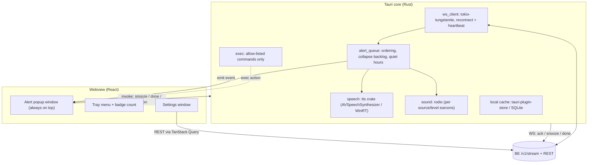

# FE Plan — `noti-reciever-fe` (desktop app, separate repo)

> Stack: **Tauri v2 · Rust (core) · React + TypeScript + Vite (UI) · Zustand · TanStack Query · CSS Modules**
> Targets: **macOS first** (Apple Silicon + Intel universal build), then Windows, from the same codebase.
> Why one codebase rather than separate native apps: see [ANSWERS.md → Q2](./ANSWERS.md#q2--separate-windows-and-mac-apps-for-better-performance).

---

## 1. Goals

- Runs **always on in the background** (tray / menu-bar app, autostart at login, single instance).
- Gets notifications from the BE in **realtime** (WebSocket), plus the **missed backlog** on reconnect.
- For each notification:
  - Plays a **distinct sound per source/level** (the main pain point today).
  - **Speaks** the message (TTS), e.g. "Jenkins, error: payment-service build failed".
  - Shows an **alert popup** with: **Snooze** (options from config, e.g. 10s / 5m), **Got it** (= done, never again), and **custom action buttons** (open URL / webhook / exec allowed command).
- **Settings UI**: CRUD source configs, manage ingest tokens, local command allow-list, voice/sound/quiet hours.

## 2. Architecture



**Key decision: networking, TTS, sound and exec live in Rust, not in the webview.**
On macOS, a hidden webview can be throttled (App Nap / timer throttling), which kills the WebSocket and delays alerts. Rust background tasks are not affected by this. The UI only renders and sends user intents via `invoke`.

## 3. Repo structure

```
noti-reciever-fe/
├─ src/                         # React UI
│  ├─ windows/
│  │  ├─ AlertPopup.tsx         # the notification card(s)
│  │  ├─ Settings/              # Sources, Tokens, Commands, Sound&Voice, Account
│  │  └─ TrayMenu.ts
│  ├─ components/               # Button, Select, Badge, LevelIcon, DurationChip...
│  ├─ api/                      # typed REST client (generated from BE OpenAPI)
│  ├─ store/                    # zustand: active alerts, connection status
│  └─ styles/                   # design tokens (CSS variables), dark/light
├─ src-tauri/
│  ├─ src/
│  │  ├─ main.rs / lib.rs       # setup, plugins, tray, windows
│  │  ├─ ws_client.rs           # connect, backoff, ping, message routing
│  │  ├─ alert_queue.rs         # dedupe, collapse, quiet hours, priority
│  │  ├─ speech.rs              # TTS queue (no overlapping speech)
│  │  ├─ sound.rs               # rodio playback
│  │  ├─ exec.rs                # allow-list validation + spawn
│  │  ├─ auth.rs                # device token in OS keychain (keyring crate)
│  │  └─ commands.rs            # #[tauri::command] snooze/done/run_action/...
│  ├─ sounds/                   # bundled earcons per source/level
│  ├─ capabilities/             # Tauri v2 permission files
│  └─ tauri.conf.json
└─ .github/workflows/release.yml  # tauri-action: build macOS + Windows
```

## 4. Tauri plugins & crates

| Need | Plugin / crate |
|---|---|
| Tray / menu-bar icon + badge | Tauri core `tray-icon` feature |
| Autostart at login | `tauri-plugin-autostart` |
| Only one instance | `tauri-plugin-single-instance` |
| Native OS notification (optional, besides popup) | `tauri-plugin-notification` |
| Open URL action | `tauri-plugin-opener` |
| Exec action (scoped allow-list) | `tauri-plugin-shell` with scope + our own `exec.rs` validation |
| Settings persistence | `tauri-plugin-store` |
| Secure token storage | `keyring` crate (macOS Keychain / Windows Credential Manager) |
| WebSocket | `tokio-tungstenite` (+ `rustls`) |
| TTS | `tts` crate |
| Sound | `rodio` |
| Global shortcut (e.g. ⌥⇧D = "done" on the top alert) | `tauri-plugin-global-shortcut` |
| Auto update | `tauri-plugin-updater` (GitHub Releases) |
| OAuth (phase 2) | `tauri-plugin-oauth` (loopback) or `tauri-plugin-deep-link` |

## 5. Notification UX

### Alert popup window
- A frameless, **always-on-top**, transparent window, anchored top-right and **stacked** (max 3 visible, then "+N more").
- Doesn't steal focus (`focus: false`), so you don't lose your typing in the IDE.
- Card content: source icon + color, level badge, title, message, relative time.
  - Buttons: **[Snooze ▾]** (from `config_snapshot.snoozeOptions`), **[Got it]**, then action buttons.
- Level colors: `info` blue-violet, `success` green-teal, `warning` amber, `error` red-coral. Dark glassmorphism style. Errors pulse until handled.
- Keyboard: `Enter` = Got it, `S` = default snooze, `1..5` = actions.

> Why a custom popup instead of only native notifications: native notification action buttons are limited and inconsistent between macOS and Windows (macOS needs notification categories, Windows toasts behave differently). They also auto-hide. A custom window gives the exact same UX on both OSes and stays until you handle it. Native notifications can stay as an optional extra (shown in Notification Center history).

### Sound + voice (main pain point)
- **Earcon per source** (short, very different sounds: Jenkins = low "thunk", GitHub = chime, GitLab = marimba, Teams = knock, Outlook = paper, Cursor/Antigravity = synth blip), followed by TTS.
- **Level changes urgency**: `error` repeats the earcon every 60s until handled (configurable); `success` is played once at low volume.
- TTS format: `"<Source>, <level if warning/error>: <title or message>"`, limited to ~200 chars.
- **Speech queue**: never overlap. A newer `error` jumps ahead of queued `info`.
- Per source: voice, rate, volume, `speak` on/off (from BE config + local override).
- **Quiet hours / Do-Not-Disturb**: during these hours, only the popup is shown with no sound (errors can be an exception).
- **Pause while in a meeting** (optional, later): detect mic in use and suppress voice.

### Backlog after being offline
- On `backlog` with more than 3 items: show **one summary card** ("12 missed · 3 errors · 9 success") and **speak only the summary**. Expanding it shows the list, with bulk "Mark all done".

### Tray menu
- Status dot (connected / reconnecting / offline), active count badge.
- Recent notifications, "Mute for 30m / 1h / until tomorrow", Settings, Quit.

## 6. Action handling

| Method | Runs on | Behaviour |
|---|---|---|
| `open_url` | FE | Template `{{url}}` / `{{meta.x}}` → `opener::open_url` |
| `webhook` | **BE** | FE calls `POST /v1/notifications/:id/actions/:idx`, so secrets stay on the server |
| `exec` | FE | Looks up `commandId` in the **local** allow-list, validates args, spawns, and shows a result toast |

### Local exec allow-list (`commands.json`, editable in Settings, **never synced from BE**)

```json
[
  { "id": "open-repo-vscode", "program": "code", "args": ["{{0}}"],
    "argPatterns": ["^[\\w./~-]+$"], "cwd": "~", "confirm": false },
  { "id": "rerun-jenkins", "program": "jenkins-cli", "args": ["build", "{{0}}"],
    "argPatterns": ["^[\\w-]+$"], "confirm": true }
]
```

Rules:
- The program must be in the list. Args are filled **only** into `{{n}}` slots and must match `argPatterns`.
- No shell is involved (`Command::new(program).args(..)`, never `sh -c`), so injection isn't possible.
- `confirm: true` → show a confirm dialog before running.
- An unknown `commandId` → the button is disabled with the tooltip "not allowed on this device".

## 7. Connection logic (`ws_client.rs`)

- Connect `wss://<be>/v1/stream` with the device token (from the keychain).
- **Heartbeat** `ping` every 25s. No `pong` within 10s → reconnect.
- **Exponential backoff** with jitter: 1s → 2s → 4s … max 60s. Reset after a successful `hello`.
- Reconnect immediately on **OS wake from sleep** and on **network change** events.
- After each `notification` is shown → send `ack`.
- Actions done while offline (`snooze` / `done`) are queued locally and flushed after reconnect (idempotent on the BE).
- A local cache of active alerts means a popup survives an app restart even before the BE answers.

## 8. Settings screens

1. **Sources**: a list of all source enums. Each has: enabled, default level, snooze options (chip editor: `10s`, `5m`, `1h`), speak on/off, actions editor (method dropdown → dynamic form), sound picker + "Test" button (plays the earcon + TTS sample).
2. **Tokens**: create an ingest token (name, allowed sources). The plaintext is shown once with a copy button. There are ready-made snippets per integration (curl, Jenkins, GitLab URL, GitHub URL, Cursor `hooks.json`, Antigravity `hooks.json`), and you can revoke tokens.
3. **Commands**: the local exec allow-list editor (with a JSON view).
4. **Sound & Voice**: master volume, voice selection, rate, quiet hours, repeat-error interval.
5. **Devices / Account**: connected devices (revoke), sign in with Google (phase 2), BE URL.

## 9. Auth flow

- **Phase 1**: on first run, paste the BE URL and a **device token** (created via `/v1/auth/bootstrap`). It's stored in the OS keychain.
- **Phase 2 (Google)**: "Sign in with Google" → system browser → OAuth Authorization Code + **PKCE**, loopback redirect `http://127.0.0.1:<port>` (`tauri-plugin-oauth`) → get the `id_token` → `POST /v1/auth/google` → receive the device token → keychain. No passwords or custom auth in the app.

## 10. Build, sign, release

- **macOS**: `tauri build --target universal-apple-darwin` → `.dmg`.
  - Internal use: unsigned is OK (right-click → Open once, or `xattr -dr com.apple.quarantine`).
  - Later: Developer ID signing + notarization ($99/yr).
- **Windows**: `.msi` / NSIS `.exe` (SmartScreen warning until signed). WebView2 ships with Windows 10/11.
- **CI**: `tauri-apps/tauri-action` builds both OSes on tag push and publishes GitHub Releases. The updater reads `latest.json` from there.
- Minimum macOS version: 10.15+ (Tauri v2).

## 11. Testing

- **Rust unit tests**: allow-list validation (injection attempts), duration parsing, backoff, alert queue ordering/collapse.
- **UI**: Vitest + React Testing Library for the popup and settings forms.
- **E2E (manual checklist at first)**: send via `curl` → sound + voice + popup; snooze 10s → comes back; Got it → gone on all devices; kill Wi-Fi → send 5 → reconnect → summary card; sleep/wake → reconnects.
- **Mock BE**: a tiny local WS server script for UI development without the real BE.

## 12. Milestones (macOS first)

| # | Milestone | Done when |
|---|---|---|
| F0 | Scaffold `create-tauri-app` (React-TS), tray icon, autostart, single instance | App lives in the menu bar |
| F1 | Rust WS client + reconnect/heartbeat + keychain token | Connection status shown in tray |
| F2 | Alert popup window + Got it / Snooze → WS messages | End-to-end with BE M3 |
| F3 | Sound per source/level + TTS queue | You can tell sources apart by ear |
| F4 | Backlog summary, quiet hours, mute from tray | – |
| F5 | Actions: open_url, webhook (via BE), exec allow-list | – |
| F6 | Settings: Sources CRUD, Tokens + snippets, Commands, Sound & Voice | Configure everything without curl |
| F7 | Windows build + CI release + auto update | Same app runs on Windows |
| F8 (phase 2) | Google sign-in, multi-device management | – |

## 13. Future

- iOS/Android companion via Tauri v2 mobile + APNs/FCM push (BE adds a push channel when no socket is connected).
- "Focus mode" integration (macOS Focus / Windows Focus Assist) to auto-mute.
- Per-repo rules (e.g. only speak failures on `main`).
